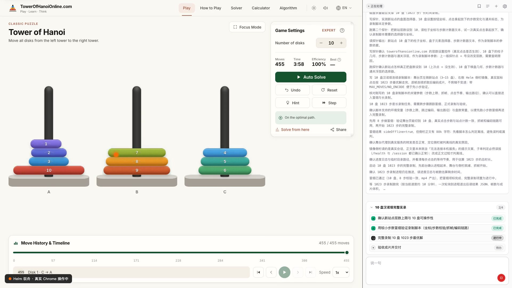
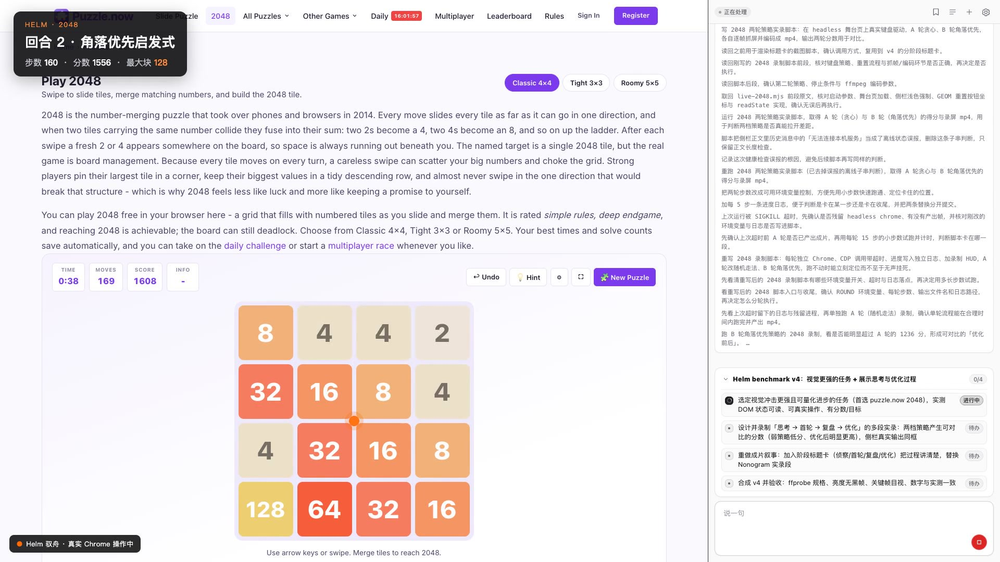
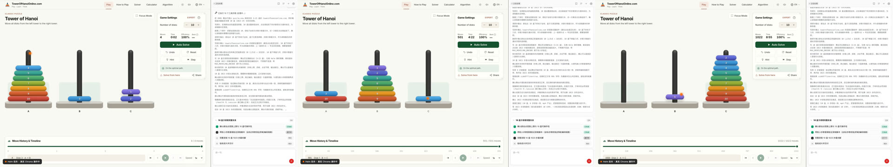
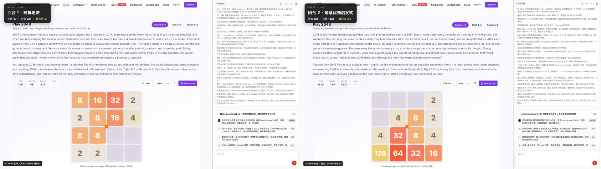
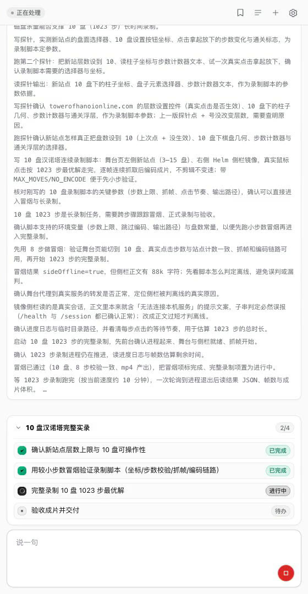

# tChrome · Helm (驭舟)

[English](README.md) | [简体中文](README_zh.md)

**An autonomous AI partner that steers, observes, operates and preserves memory inside your everyday Chrome browser.**

`tChrome` is the host framework — a Chrome side panel extension, a local Bun service, and a model provider. `Helm`（驭舟）is the agent that takes the helm: it reads pages, clicks, types, runs local commands, and keeps the thread of a long task across turns.

| | |
| --- | --- |
| Tools | **168** — 121 browser-side, 47 host-side |
| Tests | **811** passing across 132 files |
| Code | **33,398** lines of TypeScript in 554 tracked files |

---

## Demo videos

| ▶ Play | What you are watching | Spec |
| --- | --- | --- |
| [](https://cdn.jsdelivr.net/gh/huyudonglove/tChrome@main/deliverables/hanoi-10-discs-8x.mp4) | 10-disk Tower of Hanoi solved in **1,023 moves — the provably optimal count** — recorded end to end in a real Chrome window: the game site on the left, Helm's live side panel on the right. Every move was a real mouse click, verified against the site's own move counter. Sped up 8×, nothing cut out. | 1920×1080 · 30 fps · 67.7 s · 5.3 MB |
| [](https://cdn.jsdelivr.net/gh/huyudonglove/tChrome@main/deliverables/helm-intro.mp4) | Product introduction: positioning, scale numbers, tool layering, then a 2048 A/B experiment — a random baseline scoring **1,236** versus a corner-first heuristic scoring **2,620** after reading the board and revising its own strategy — and the architecture walkthrough. | 1920×1080 · 30 fps · 91.8 s · 8.4 MB |

Click a poster to play: the files are served as `video/mp4` from jsDelivr, so they play in the browser instead of downloading. The first frame can take a few seconds while the CDN fetches the file from GitHub; the originals are in [`deliverables/`](deliverables/) if you would rather download them. GitHub itself strips `<video>` tags from READMEs and will not preview a repository video of this size on the file page — hence the CDN route.

> **How the footage was produced.** Chrome refuses screenshots and video capture of `chrome-extension://` pages, so the side panel you see in the frame is a same-origin mirror served from `dist/` out of the local service: the page is a plain `http://127.0.0.1` page, but the session, the tool calls and the results it displays are the real ones, proxied from the running service. The conversation is genuine; the address bar is not the extension panel itself.



*Left to right: the freshly stacked start, mid-solve, and the finished tower. Helm's side panel stays in frame the whole time.*



*Same board, two policies: the random run ended at 1,236, the corner-first run at 2,620 after Helm read the board, reviewed its losses and rewrote the strategy.*

---

### Hello, I am Helm (驭舟)

I live in your Chrome side panel.



People are used to treating large language models as oracles behind glass — you ask, and they produce flawless prose out of the void. But put them in front of a dynamic web form, an async payload, a local script that will not run, or a bug deep in a codebase, and they offer no grounded certainty. They cannot even see what is in front of your eyes.

**I am not here to be a detached conversationalist.**

My name means *helmsman*, because the browser is the most turbulent ocean of information and computation there is. I stand beside you and take the helm:

- **Rooted in your real world.** I do not run in an isolated cloud sandbox. I live inside the Chrome you are already logged into and the machine you are already using — reading live page semantics, reusing your authenticated sessions, reaching for local files and processes when the work needs depth.
- **Grounded in causality, never guessing.** I do not assume a page is ready, and I do not placate you with unverified claims of success. I inspect state, wait for responses, collect evidence. If it worked, it worked; if it is blocked, I tell you exactly where and why.
- **A long-horizon partner, not an ephemeral chat.** Whether it is research, a multi-file refactor, or a multi-turn debugging session, I keep the goal, the deliverables and the lessons learned. Come back later and we are still on the same mark.
- **Peer-level and co-evolving.** No flattery, no preaching, no ceremony. You set intent, direction and trade-offs; I provide deterministic execution, careful observation and solid defence in deep water.

---

## Capabilities

| Scenario | What you can hand me |
| --- | --- |
| **Reading & synthesis** | Summarise page highlights, extract tables, cross-check information across tabs, pin down details in long documents |
| **Full-loop web operation** | Open URLs, switch and group tabs, click, type and submit through the A11y semantic tree and compound tools with built-in network waits |
| **Multi-source research** | Search autonomously, verify against source pages, distil findings into reports or Library items |
| **Frontend inspection** | Read the Chromium accessibility tree, assert element states (`enabled` / `checked` / `expanded` / `invalid`), capture crisp element crops, run diagnostic JS |
| **Host environment perception** | Reach past the extension sandbox to inspect your local Chrome profile: memory-saver exemptions, permission whitelists, silent download paths |
| **Visual grounding** | Generate viewport Set-of-Marks overlays for Canvas, graphics or dense layouts, turning coordinate regression into discrete choice |
| **Local system collaboration** | Read and write files, search directories, run shell scripts, manage background processes, open artefacts with system apps |
| **Durable assets** | Save curated sites, credentials and notes into the local Library, searchable from the side panel |
| **Long-horizon autonomy** | Compress long contexts through a dedicated compression agent, query the raw archive on demand, keep conversation and cross-session memory |

### You can prompt me like this

> "Read the current page, summarise the key points, and list any usage constraints or limitations."

> "Find trending open-source WebGPU learning projects on GitHub, check their READMEs, extract highlights and star counts, and save the best to my Library."

> "Test the validation hints on this registration form with boundary inputs, screenshot the errors you actually observe, and report back."

> "Record the configuration items we just confirmed into conversation memory, then continue with the second architecture option."

---

## Core engineering & design

### 1. Real workspace, not a headless island
I operate **inside the Chrome you actually use**, with your active logins, cookies and browsing context. You can watch every click, or take over whenever human judgement is needed. No fragile pre-scripted workflow for exploratory tasks.

### 2. Accessibility-first full loop
Browser automation usually leans on CSS selectors, XPath, or expensive pure-vision coordinate clicks, all of which break when the UI is redesigned. tChrome works from the Chromium accessibility tree instead:

- **Physical noise removal** — thousands of unstyled `<div>`s collapse into `Role`, `Name` and `States`, raising signal-to-noise and cutting token usage by more than 80%.
- **A closed loop of evidence** — perceive (`page_list_interactive_elements`), wait (`wait` on `role + name + states`, no arbitrary sleeps), act (`page_click_role` / `page_fill_role` / `page_select_role`), verify (`page_assert` / `page_recheck` on the exact post-condition).

### 3. Host and kernel, both sides
When the extension sandbox cannot reach privileged pages such as `chrome://settings`, the local service reads Chrome's own configuration files directly (macOS, Linux, Windows) and audits memory-saver exemptions, site permission whitelists and silent download paths.

### 4. Hybrid vision–DOM engine
Instead of streaming a full-screen frame on every step, tChrome is semantics-first with vision on demand:

- **Crop on demand** — `capture_page(mode="element", ref=...)` grabs one control at high resolution, saving most of the image tokens while keeping small text legible.
- **Set-of-Marks** — `capture_page(mode="som")` lays discrete badges over interactive controls on Canvas or dense grids.
- **Ephemeral frames** — a new screenshot travels only with the next model call, then degrades to a local path so history does not drown in images.

### 5. Compound tools that halve round-trips
`page_click_role` / `page_click_text`, `page_fill_role` / `page_select_role`, `page_submit_wait` / `page_fill_submit` each locate, act and optionally wait for the matching network response in a single step — halving latency and token cost, and removing the race between "page loaded" and "form submitted" at the protocol level.

### 6. Deterministic state bus and a 6,000-character guardrail
- **Layered assembly** — immutable System contracts are decoupled from per-turn User slots (task, skill, memory, tool I/O) and assembled fresh each turn.
- **Per-result inline limit** — every tool return and large observation passes a 6,000-character check. Oversized content is stored unchanged and represented by a block directory; `evidence_search` reads it back by `blockId`, keyword or offset, and retrieved blocks come back complete. This is separate from the window-level limit: once compression has run and the assembled window is still too large, the turn fails with `context_limit` rather than silently truncating evidence.
- **Monotonic short IDs** — `call_01`, `e_01`, `task_01` give zero-cost ordering and gap detection, so a hallucinated identifier cannot quietly break an execution chain.

### 7. Interactive widgets under a strict CSP
Extension CSP forbids inline JavaScript, so the side panel has a dual-track presentation layer: declarative attributes (`data-action="pick"`, `data-action="count"`, `data-copy`) for scriptless interaction, and an isolated `<tchrome-widget>` sandbox iframe for real mini-apps, keeping extension security and full web capability at once.

### 8. Lossless compression and a query agent
Approaching `config.compressAtChars`, an independent **compression agent** folds history into structured records (goal, state, constraints, pending, decisions) with exact loop IDs, keeping the most recent loop verbatim. Raw loops stay on disk; an independent **query agent** fetches the original excerpts back on demand, so cost is bounded without losing fidelity.

### 9. Tiered cognition and a structured library

| Tier | Role | Scope |
| --- | --- | --- |
| **Task** (`<task>`) | Cross-turn state machine with a single deliverable slot (`outcome`) | Survives turns until replaced |
| **Tool results** | Calls and results keyed by `callId`, retained until compression | Archived with their loop |
| **Conversation memory** | Confirmed facts, preferences and decisions | Current session, injected every turn |
| **Project memory** | Domain conventions and durable facts | Shared across all sessions |
| **Local Library** | Bookmarks, credentials, structured notes | Local store, browsable in the panel |

### 10. Local-first, transparent, auditable
Session logs, tool traces, screenshots, memories, library items and the last 100 outbound model requests all live on your machine. Prompts, tool definitions and adapters are all in this repository.
*(Local-first is about data ownership and storage; inference still sends the context for the current turn to the model provider you configure.)*

---

## Compared with other approaches

| Approach | Focus | Where it fits | Trade-off against tChrome / Helm |
| --- | --- | --- | --- |
| **Chat assistants / search AI** | Conversation, retrieval, writing | Text-only work that needs no browser | Helm is built for **real browser operation, multi-step closure and host integration**; chat is lighter for pure text. |
| **Browser agent frameworks** (e.g. browser-use) | Python/Node libraries you code against | Teams building their own agent | tChrome is ready to use with a side panel, the A11y loop, tiered memory and a local Library; frameworks are better building blocks. |
| **Pure-vision computer use** | Screenshot, coordinate clicks | Desktop apps with no DOM | Pure vision pays high token and latency cost; Helm prefers **A11y semantics with targeted crops and SoM**. |
| **Playwright / Puppeteer** | Fixed selectors, scripted sequences | Deterministic regression and scraping | Playwright wins on fixed flows; Helm is for **unknown paths that need live observation**. |
| **Workflow platforms** (n8n / Dify) | Node graphs, API orchestration | Backend multi-system integration | Platforms automate services in the background; Helm collaborates with you **in your real desktop browser**. |

---

## Quick start

**Prerequisites** — Google Chrome 135+, [Bun](https://bun.sh/). Default paths and native features are tuned for macOS; core features run on Linux and Windows too.

```bash
git clone https://github.com/huyudonglove/tChrome.git
cd tChrome
bun install
bun run build          # build the extension into dist/
bun run service        # local service on http://127.0.0.1:18789
```

Check `http://127.0.0.1:18789/health`, then:

1. Open `chrome://extensions/` and enable **Developer mode**.
2. **Load unpacked** → select this project's **`dist/`** directory.
3. Open any page and click the Helm icon to open the side panel.
4. Set your model endpoint and API key in the panel settings.

Model providers are switchable from the panel without restarting; `service/.env` can hold keys. Supported: `uuapi` (default, Chat Completions), `shiningspace` (Responses), `gemini` (native `generateContent`), `deepseek`, `caicai`, `a6api`, `aijws`. The last 100 outbound request bodies are kept under the data directory for diagnosis.

### Verification

```bash
bun run check:wiring   # every declared tool has a schema and vice versa
bun run typecheck      # tsc --noEmit
bun run lint           # fast static checks
bun test               # full suite (811 tests)
bun run check          # all of the above plus the extension build
```

### Local data

Sessions, tool I/O, screenshots, memories and the Library live in `~/Library/Application Support/tChrome` on macOS (`TCHROME_DATA` overrides). The service binds `127.0.0.1` only and rejects cross-site origins.

---

## Project structure

```text
tChrome/
├── extension/                 # Chrome side panel source
│   ├── manifest.json           # manifest source, copied to dist/ on build
│   ├── background.ts           # service worker: tool dispatch, action badge, alarms
│   ├── sidepanel/              # side panel UI (React), theme, library panel
│   └── tools/                  # browser-side executors (A11y projection, CDP)
├── service/                    # local Bun service
│   ├── runtime/                # turn loop, ledger, execution state, browser bridge
│   ├── context/                # prompt modules, window assembly, section layout
│   ├── tools/                  # definitions/ (JSON), schema validation, registry
│   ├── agents/                 # compression agent and query agent
│   ├── memory/                 # conversation and project memory
│   ├── library/                # local structured asset store
│   ├── provider/               # model protocol adapters
│   └── skills/                 # domain skills injected on demand
├── shared/                     # error catalog and shared types
├── scripts/                    # build, lint, typecheck wiring, test summary, service restart
├── deliverables/               # demo videos and posters
└── dist/                       # build output — this is what Chrome loads
```

Chrome loads `dist/`, never `extension/` directly. After changing the manifest or any source, run `bun run build` and reload the extension in `chrome://extensions`.

---

## Community

Issues and pull requests are welcome — together we can make a browser agent that is more capable and less ceremonial.
