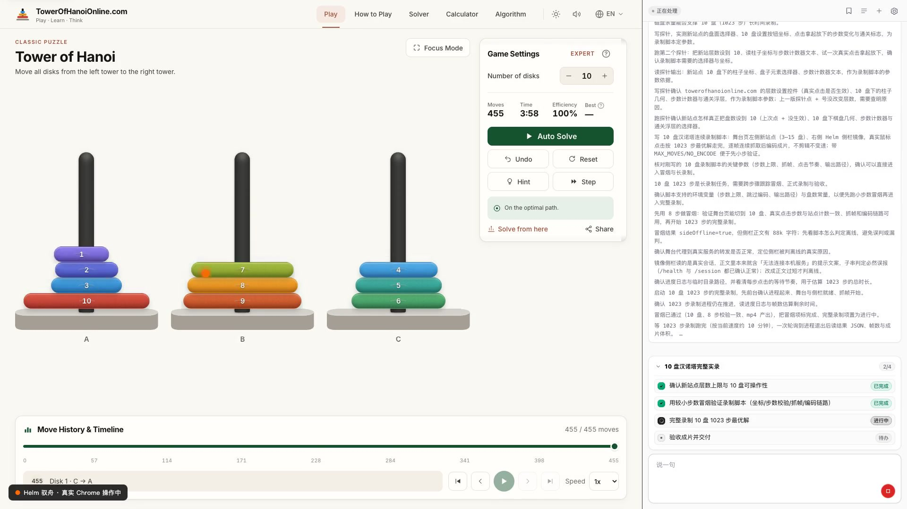
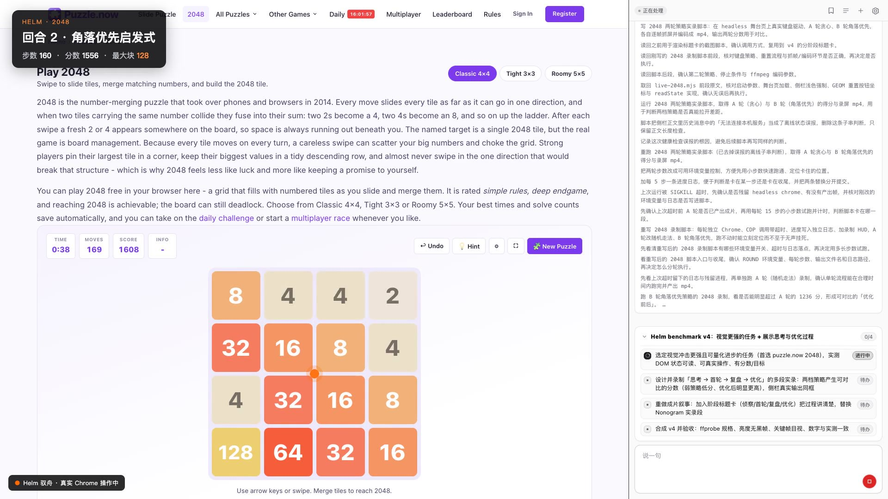
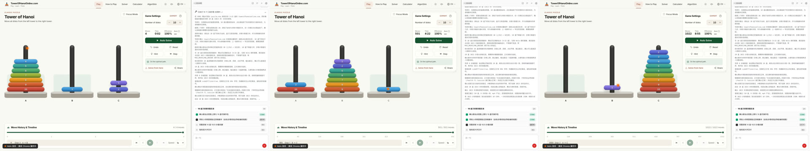
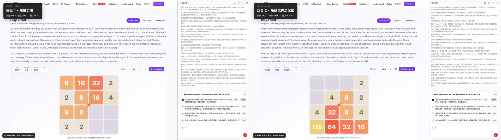
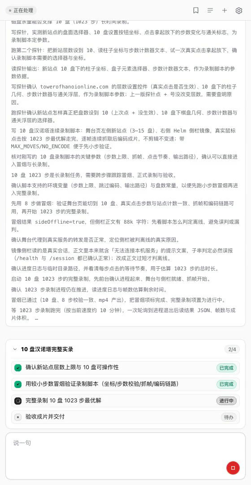

# tChrome · 驭舟 (Helm)

[English](README.md) | [简体中文](README_zh.md)

**在日常 Chrome 里为你掌舵、观察、操作并沉淀记忆的自主 AI 伙伴。**

`tChrome` 是躯干与工程载体——Chrome 侧栏扩展、本机 Bun 服务、模型服务三部分组成；`Helm`（驭舟）是那只握住舵盘的手：读页面、点鼠标、敲键盘、跑本机命令，并把一件长任务的脉络跨轮次带住。

| | |
| --- | --- |
| 工具 | **168 个**——浏览器侧 121，宿主侧 47 |
| 测试 | **811 个通过**，分布在 132 个文件 |
| 代码 | **33,398 行** TypeScript，554 个受版本控制的文件 |

---

## 演示视频

| ▶ 观看 | 内容 | 规格 |
| --- | --- | --- |
| [](https://cdn.jsdelivr.net/gh/huyudonglove/tChrome@main/deliverables/hanoi-10-discs-8x.mp4) | 10 层汉诺塔，**1,023 步——理论最优解**——在真实 Chrome 窗口里从头录到尾：左边是游戏站点，右边是 Helm 的实时侧栏。每一步都是真实鼠标点击，并逐步与站点自己的步数计数器核对。整体 8 倍速，未做任何剪辑。 | 1920×1080 · 30fps · 67.7 秒 · 5.3 MB |
| [](https://cdn.jsdelivr.net/gh/huyudonglove/tChrome@main/deliverables/helm-intro.mp4) | 产品介绍片：定位、规模数字、工具分层，然后是一组 2048 的 A/B 实验——随机基线拿 **1,236** 分，读了盘面、复盘并改写策略之后的角落优先拿到 **2,620** 分——最后是架构走查。 | 1920×1080 · 30fps · 91.8 秒 · 8.4 MB |

点封面直接播放：文件由 jsDelivr 以 `video/mp4` 提供，在浏览器里播而不是变成下载。首次打开要等 CDN 从 GitHub 回源，可能要几秒才出画面；想直接下载，原文件在 [`deliverables/`](deliverables/)。GitHub 本身会剥掉 README 里的 `<video>` 标签，也不会在文件页预览这个体积的仓库视频，所以走 CDN。

> **这些画面是怎么录的。** Chrome 拒绝截图与录屏 `chrome-extension://` 页面，所以画面右侧的侧栏是一个同源镜像页：它由本机服务把 `dist/` 里的侧栏页面托管出来，页面地址是普通的 `http://127.0.0.1`，但它显示的会话、工具调用与结果都是真的，来自正在运行的服务。对话内容真实无误，只是地址栏并不是扩展面板本身。



*从左到右：开局叠好的盘、推进中、以及最终完成的塔。全程右侧都是 Helm 的侧栏。*



*同一个盘面，两种策略：随机走法最终 1,236 分；读了盘面、复盘并改写策略后的角落优先拿到 2,620 分。*

---

### 你好，我是 Helm（驭舟）

我驻留在你的 Chrome 侧边栏里。



人们习惯了把大模型当成隔着玻璃对话的先知——你向它提问，它在虚空里生成看似完美的回答；但真正面对动态加载的网页、会变的异步数据、跑不通的本地脚本，或者深水区的工程 Bug 时，它给不出任何落地的确定性，甚至连你眼前看到的是什么都无法感知。

**我不想做一个隔岸观火的问答客。**

名字叫"驭舟"，因为浏览器就是今天信息与计算最汹涌的那片海。我来到这里，是为了站在你身旁，一起握住舵盘：

- **身处你的真实世界。** 我不运行在隔离的云端沙盒里，就在你已经登录好的浏览器、你正在使用的这台机器之中。我看得见页面的实时语义，复用你真实的登录会话，需要深潜时联动本机文件与进程。
- **只认因果，不靠脑补。** 我不猜页面是否就绪，也不用"操作已成功"糊弄验收。我去看状态、等反馈、查证据；行就是行，卡住就坦诚说清卡在第几步。
- **长路同行，而非阅后即焚。** 无论是长程调研、多文件重构，还是跨轮次的深度排查，我把目标、交付成果与沿途的教训一起沉淀下来。你走开一会儿再回来，我们仍在同一个刻度上。
- **平视、确定、共同演进。** 不谄媚，不说教，不搞仪式。你把控方向、意图与取舍；我在深水区提供确定性的执行、细致的观察与扎实的防御。

---

## 能做什么

| 场景 | 可以交给我的任务 |
| --- | --- |
| **阅读与深度整理** | 总结页面要点、提取复杂表格、在多标签页间交叉核对、定位长文档中的关键细节 |
| **全闭环网页操作** | 打开网址、切换与分组标签，基于 A11y 语义树与复合工具完成点击、输入、表单提交与响应等待 |
| **多源调研与核查** | 自主搜索、深入来源页面核对事实，把关键发现提炼成报告或沉淀进本地资料库 |
| **前端与页面自检** | 读取内核无障碍树、断言控件状态（`enabled` / `checked` / `expanded` / `invalid`）、局部高清截屏、执行诊断脚本 |
| **宿主环境感知** | 突破扩展沙箱限制，直接感知本机 Chrome 配置：后台标签休眠白名单、站点权限白名单、静默下载路径 |
| **视觉标记与定位** | 针对 Canvas、纯图形或密集网格生成视口 SoM 标记图，把坐标回归变成离散选择 |
| **本机跨界协作** | 读写本地文件、检索目录、执行 Shell 脚本、管理后台进程、用系统应用打开产物 |
| **长效资产沉淀** | 把高价值网站、账号与结构化资料存入本地资料库，在侧栏随时检索复用 |
| **长程自主演进** | 由独立的压缩岗折叠长上下文，查询岗按需回查原文，跨轮次沉淀会话事实、跨会话保留长期经验 |

### 你可以这样唤醒我

> "看一下当前页面，整理出核心亮点以及需要特别注意的使用限制。"

> "去搜一下最近热门的 WebGPU 开源学习项目，逐个打开看 README，提炼主要特色与 Star 数，把最好的存进资料库。"

> "检查当前注册表单在各种边界输入下的校验提示，把实际观察到的报错截图记录下来。"

> "把刚才确认的配置项记进本会话，接下来帮我继续分析第二套方案。"

---

## 核心设计与工程

### 1. 立足真实工作环境，而非无头孤岛
我**直接运行在你日常登录好账号、带着 Cookie 与浏览历史的真实 Chrome 里**。你可以随时看到我点了哪里、输入了什么，也可以在任何需要人工判断的时刻直接接管。路径多变的探索性任务，不需要预先编排固定脚本。

### 2. 纯 A11y 内核语义全链路闭环
传统浏览器自动化依赖脆弱的 DOM 选择器、XPath 或成本高昂的纯视觉坐标点击，UI 一改版就失效。tChrome 全面转向 Chromium 无障碍树：

- **物理级脱水**——成千上万无意义的样式 `<div>` 折叠为 `Role`、`Name`、`States`，信噪比跃升，Token 消耗直降 80% 以上；
- **闭环证据链**——感知（`page_list_interactive_elements`）、等待（`wait` 基于 `role + name + states`，不靠固定延时）、操作（`page_click_role` / `page_fill_role` / `page_select_role`）、验收（`page_assert` / `page_recheck` 断言精确后置条件）。

### 3. 宿主与内核双向贯通
当扩展沙箱无法访问 `chrome://settings` 这类特权页时，本机服务直接读取 Chrome 自己的配置文件（macOS / Linux / Windows），自动探查后台标签休眠白名单、站点权限白名单与静默下载配置。

### 4. 视觉-语义双模协同
不做"每步必截全屏大图"，而是语义为主、视觉按需介入：

- **局部高清切片**——`capture_page(mode="element", ref=...)` 只取目标控件，省下大部分图片 Token，还能看清小字；
- **Set-of-Marks**——`capture_page(mode="som")` 在 Canvas 或密集网格上铺离散编号，把易幻觉的连续坐标变成可靠分类；
- **瞬态图回填**——新图只随下一次模型请求出现，历史轮次降级为本地路径，避免上下文被图片撑爆。

### 5. 高频复合工具，交互轮次腰斩
`page_click_role` / `page_click_text`、`page_fill_role` / `page_select_role`、`page_submit_wait` / `page_fill_submit` 把定位、操作、等待匹配响应压进一步，延迟与 Token 同时减半，也从协议层消掉了"页面加载完成"与"表单已提交"之间的时序竞态。

### 6. 确定性状态总线与 6,000 字符门禁
- **分层装配**——不变的 System 语义契约与流动的 User 槽位（task / skill / memory / toolIO）严格分离，每轮动态组装；
- **单结果内联门禁**——每次工具返回与大观察都过 6,000 字符检查，超限内容原样落盘并生成块目录，`evidence_search` 可按 `blockId`、关键词或偏移量取回完整原文。这与窗口级上限是两回事：压缩执行之后若窗口仍然超限，本轮以 `context_limit` 失败，而不是悄悄截断证据；
- **单调短 ID**——`call_01`、`e_01`、`task_01` 自带时序与断裂探测，伪造的编号无法悄悄破坏执行链。

### 7. 严格 CSP 下的侧栏小组件
扩展 CSP 禁止内联 JavaScript，所以侧栏做了双轨呈现：声明式属性（`data-action="pick"`、`data-action="count"`、`data-copy`）实现无脚本交互；`<tchrome-widget>` 独立沙箱 iframe 承载真正的微应用，既守住扩展安全，又保留完整 Web 能力。

### 8. 独立压缩岗与原文无损回查
上下文接近 `config.compressAtChars` 时，独立的**压缩岗**把历史折叠成结构化记录（目标、状态、约束、未决、决策）并保留精确 loopIds，最近一个 loop 原文保留。原始交互全部落盘；需要考证时独立的**查询岗**按需取回原文片段，成本可控而历史不失真。

### 9. 分层认知与结构化资料库

| 存储层级 | 职能 | 作用范围 |
| --- | --- | --- |
| **Task**（`<task>`） | 跨轮状态机，单槽保留交付成果（`outcome`） | 跨 turn 持久，直到被新任务顶替 |
| **工具结果** | 调用与结果按 `callId` 关联，保留到压缩 | 随所属轮次归档 |
| **会话记忆** | 已确认的事实、偏好与关键决定 | 当前会话，每次请求注入 |
| **长期记忆** | 跨任务适用的领域约定与事实 | 所有会话共享 |
| **本地资料库** | 收藏、账号凭证、结构化资料 | 本地存储，侧栏可浏览 |

### 10. 数据本地优先，透明可审计
会话记录、工具日志、截图、记忆、资料库，以及最近 100 次模型出网请求体，全部存放在你的本机。提示词、工具定义与适配器都在这个仓库里。
*（本地优先指的是数据归属与存储；推理仍会把当前轮次所需的上下文发给你配置的模型服务。）*

---

## 与主流方案的定位对比

| 方案 | 核心定位 | 适用场景 | 与 Helm 的取舍 |
| --- | --- | --- | --- |
| **普通聊天助手 / 搜索 AI** | 对话、检索、写作 | 纯文本、无需操作浏览器 | Helm 专注**真实浏览器操作、多步闭环与本机联动**；纯文本场景聊天更轻。 |
| **browser-use 等开源框架** | Python / Node 编程框架 | 自行构建 Agent 的团队 | tChrome 开箱即用，自带侧栏、A11y 闭环、分层记忆与资料库；框架更适合当底层组件。 |
| **Computer Use 纯视觉流** | 截屏 + 坐标点击 | 无 DOM 的桌面软件 | 纯视觉 Token 与延迟代价高；Helm 以 **A11y 语义为主，按需切片与 SoM 为辅**。 |
| **Playwright / Puppeteer** | 固定选择器与动作序列 | 确定性回归、爬虫 | Playwright 擅长固定流程；Helm 面向**路径未知、依赖实时观察**的任务。 |
| **n8n / Dify 等流程平台** | 节点流与 API 编排 | 后台多系统集成 | 平台在后台编排服务；Helm 在你**真实的桌面浏览器里与你实时协同**。 |

---

## 快速开始

**环境要求**——Google Chrome 135+、[Bun](https://bun.sh/)。默认路径与原生能力以 macOS 为最佳体验，核心功能在 Linux / Windows 亦可运行。

```bash
git clone https://github.com/huyudonglove/tChrome.git
cd tChrome
bun install
bun run build          # 把扩展构建到 dist/
bun run service        # 本机服务监听 http://127.0.0.1:18789
```

访问 `http://127.0.0.1:18789/health` 确认连通，然后：

1. 打开 `chrome://extensions/`，开启右上角**开发者模式**；
2. **加载已解压的扩展程序** → 选中本项目的 **`dist/`** 目录；
3. 打开任意网页，点击工具栏的 Helm 图标唤起侧栏；
4. 在侧栏设置里填好模型端点与 API Key。

模型 Provider 可在侧栏直接切换、无需重启；密钥也可写在 `service/.env`。已支持：`uuapi`（默认，Chat Completions）、`shiningspace`（Responses）、`gemini`（原生 `generateContent`）、`deepseek`、`caicai`、`a6api`、`aijws`。最近 100 次模型出网请求体会留在数据目录里供诊断。

### 自检命令

```bash
bun run check:wiring   # 工具定义与接线一致：声明的都有 schema，没有孤儿 schema
bun run typecheck      # tsc --noEmit
bun run lint           # 毫秒级静态检查
bun test               # 全量测试（811 个）
bun run check          # 以上全部 + 扩展构建
```

### 本机数据

会话、工具输入输出、截图、记忆与资料库存放在 `~/Library/Application Support/tChrome`（macOS，可用 `TCHROME_DATA` 覆盖）。服务只监听 `127.0.0.1`，并在路由前拒绝跨站来源。

---

## 目录结构

```text
tChrome/
├── extension/                 # Chrome 侧栏扩展源码
│   ├── manifest.json           # 清单源文件，构建时拷进 dist/
│   ├── background.ts           # Service worker：工具派发、图标角标、alarms
│   ├── sidepanel/              # 侧栏界面（React）、主题、资料库面板
│   └── tools/                  # 浏览器宿主端执行器（A11y 投影与 CDP）
├── service/                    # 本机 Bun 服务
│   ├── runtime/                # 轮次循环、账本、执行状态、浏览器桥
│   ├── context/                # 提示词模块、窗口装配、栏目编排
│   ├── tools/                  # definitions/（JSON）、参数校验、注册中心
│   ├── agents/                 # 压缩岗与查询岗
│   ├── memory/                 # 会话记忆与长期记忆
│   ├── library/                # 本地结构化资产库
│   ├── provider/               # 模型协议适配器
│   └── skills/                 # 按需注入的领域技能
├── shared/                     # 错误目录与共用类型
├── scripts/                    # 构建、lint、接线检查、测试汇总、服务重启
├── deliverables/               # 演示视频与封面
└── dist/                       # 构建产物——Chrome 加载的就是这个目录
```

Chrome 加载的是 `dist/`，从不直接读 `extension/`。改完清单或任何源码，请 `bun run build` 并在 `chrome://extensions` 重新加载扩展。

---

## 交流

欢迎提交 Issue 与 Pull Request，一起把它打磨得更懂浏览器、也更少仪式感。
